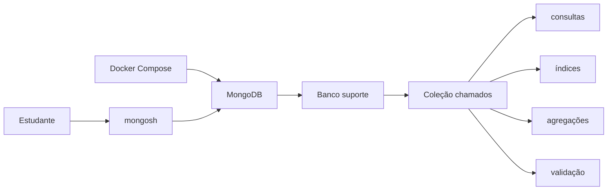
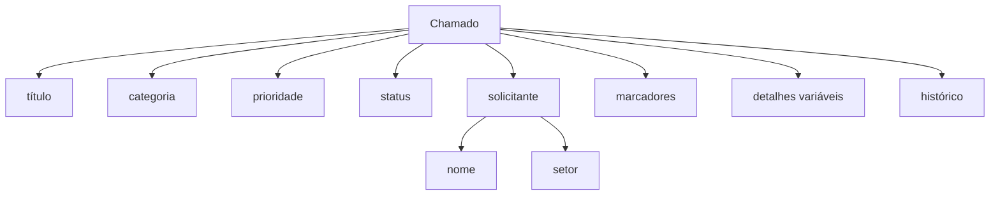

# Encontro 16 — Prática de revisão: MongoDB com Docker

## Objetivo

Revisar, de forma prática e guiada, os fundamentos de NoSQL estudados no
encontro 15. Ao final, o estudante terá configurado um MongoDB com Docker,
modelado uma coleção, inserido e consultado documentos, realizado atualizações,
criado índices, executado uma agregação e configurado validação.

Esta prática utiliza somente Docker, MongoDB e `mongosh`. A integração com o
projeto NestJS será realizada no encontro 17.

## Situação

Uma equipe de suporte precisa registrar chamados internos. Os chamados podem
ter informações comuns, como título, prioridade e status, mas algumas
categorias possuem detalhes próprios:

- chamados de equipamento podem informar patrimônio e localização;
- chamados de software podem informar sistema e versão;
- chamados de acesso podem informar recurso e perfil solicitado.

Além de guardar formatos ligeiramente diferentes, a equipe precisa:

- consultar chamados por status, categoria e prioridade;
- localizar chamados por marcador;
- registrar mudanças no histórico;
- contar chamados por categoria;
- impedir documentos sem os campos essenciais.

O modelo documental será usado para representar essa situação.

## Resultado esperado



## Antes de começar

Confirme que Docker e Docker Compose estão disponíveis:

```bash
docker --version
docker compose version
```

O primeiro comando mostra a versão do Docker Engine. O segundo confirma que o
subcomando `compose` pode ser usado para administrar o ambiente definido em
YAML. Se algum deles falhar, corrija a instalação antes de continuar.

Crie uma pasta exclusiva para a prática. Ela não precisa fazer parte do projeto
NestJS.

## Passo 1 — Preparar o Docker Compose

Crie um arquivo `compose.yaml`:

```yaml
services:
  mongo:
    image: mongo:8
    environment:
      MONGO_INITDB_ROOT_USERNAME: admin
      MONGO_INITDB_ROOT_PASSWORD: admin
    ports:
      - "27017:27017"
    volumes:
      - mongo_data:/data/db

volumes:
  mongo_data:
```

O arquivo determina como o laboratório será executado:

- `services` reúne os contêineres;
- `mongo` é o nome do serviço;
- `image: mongo:8` utiliza a versão 8 da imagem oficial;
- `environment` define o usuário administrativo inicial;
- `ports` permite acessar o MongoDB pela porta 27017;
- `mongo_data:/data/db` mantém os dados fora do ciclo de vida do contêiner;
- a seção final declara o volume gerenciado pelo Docker.

As credenciais são didáticas e só devem ser usadas localmente.

## Passo 2 — Iniciar e observar o serviço

```bash
docker compose up -d
docker compose ps
docker compose logs mongo
```

`up -d` cria e inicia o serviço em segundo plano. `ps` mostra seu estado.
`logs mongo` permite observar a inicialização e diagnosticar erros.

O resultado esperado em `ps` é o serviço `mongo` em execução. Se ele
encerrar, procure nos logs mensagens sobre porta ocupada, volume ou
configuração.

## Passo 3 — Entrar no shell

```bash
docker compose exec mongo mongosh -u admin -p admin --authenticationDatabase admin
```

Neste comando:

- `exec mongo` executa um programa dentro do serviço;
- `mongosh` abre o shell do MongoDB;
- `-u` e `-p` fornecem usuário e senha;
- `--authenticationDatabase admin` informa onde o usuário foi criado.

No shell, confira os bancos:

```javascript
show dbs
```

`show dbs` lista os bancos que já possuem dados persistidos.

## Passo 4 — Selecionar o banco

```javascript
use suporte
```

`use suporte` seleciona o banco para os próximos comandos. Ele ainda pode não
aparecer em `show dbs`, pois o MongoDB só o materializa após a primeira
gravação.

Confira a seleção:

```javascript
db.getName()
```

`db` representa o banco atual e `getName()` retorna seu nome. O resultado
deve ser `suporte`.

## Passo 5 — Planejar o documento

Antes de inserir, observe a estrutura pretendida:



O solicitante será incorporado porque seus dados são exibidos junto ao chamado.
O histórico será um array de subdocumentos. `detalhes` aceitará campos
diferentes conforme a categoria.

## Passo 6 — Inserir o primeiro chamado

```javascript
db.chamados.insertOne({
  titulo: "Monitor sem imagem",
  categoria: "equipamento",
  prioridade: "alta",
  status: "aberto",
  solicitante: {
    nome: "Ana",
    setor: "Financeiro"
  },
  marcadores: ["monitor", "hardware"],
  detalhes: {
    patrimonio: "PAT-2048",
    localizacao: "Sala 12"
  },
  historico: [
    {
      status: "aberto",
      instante: new Date(),
      observacao: "Chamado registrado"
    }
  ],
  criadoEm: new Date()
})
```

`db.chamados` seleciona a coleção e `insertOne` insere um documento.
`new Date()` grava o instante atual como data BSON. Como `_id` não foi
informado, o MongoDB gera um `ObjectId`.

Observe a resposta:

- `acknowledged: true` indica que a escrita foi confirmada;
- `insertedId` contém o identificador criado.

## Passo 7 — Inserir documentos diferentes

```javascript
db.chamados.insertMany([
  {
    titulo: "Erro ao abrir sistema acadêmico",
    categoria: "software",
    prioridade: "media",
    status: "em_atendimento",
    solicitante: {
      nome: "Bruno",
      setor: "Secretaria"
    },
    marcadores: ["sistema", "navegador"],
    detalhes: {
      sistema: "Portal Acadêmico",
      versao: "2026.3",
      navegador: "Firefox"
    },
    historico: [
      {
        status: "aberto",
        instante: new Date(),
        observacao: "Chamado registrado"
      },
      {
        status: "em_atendimento",
        instante: new Date(),
        observacao: "Análise iniciada"
      }
    ],
    criadoEm: new Date()
  },
  {
    titulo: "Solicitação de acesso ao relatório",
    categoria: "acesso",
    prioridade: "baixa",
    status: "aberto",
    solicitante: {
      nome: "Carla",
      setor: "Compras"
    },
    marcadores: ["permissao", "relatorio"],
    detalhes: {
      recurso: "Relatório de fornecedores",
      perfilSolicitado: "leitura"
    },
    historico: [
      {
        status: "aberto",
        instante: new Date(),
        observacao: "Aguardando autorização"
      }
    ],
    criadoEm: new Date()
  },
  {
    titulo: "Teclado com defeito",
    categoria: "equipamento",
    prioridade: "media",
    status: "fechado",
    solicitante: {
      nome: "Diego",
      setor: "Biblioteca"
    },
    marcadores: ["hardware"],
    detalhes: {
      patrimonio: "PAT-3100"
    },
    historico: [
      {
        status: "fechado",
        instante: new Date(),
        observacao: "Equipamento substituído"
      }
    ],
    criadoEm: new Date()
  }
])
```

`insertMany` recebe um array e insere vários documentos. Observe que
`detalhes` não possui o mesmo formato em todos eles. Essa flexibilidade é
intencional, mas os campos essenciais permanecem consistentes.

## Passo 8 — Visualizar os documentos

```javascript
db.chamados.find()
```

`find()` sem argumentos seleciona todos os documentos. Use esse comando
apenas em uma coleção pequena de laboratório.

Conte os documentos:

```javascript
db.chamados.countDocuments()
```

`countDocuments()` conta os documentos que correspondem ao filtro. Sem
argumento, conta toda a coleção. O resultado esperado é `4`.

## Passo 9 — Praticar filtros

Chamados abertos:

```javascript
db.chamados.find({ status: "aberto" })
```

O objeto passado ao `find` é o filtro. Aqui é usada igualdade.

Chamados abertos e de alta prioridade:

```javascript
db.chamados.find({
  status: "aberto",
  prioridade: "alta"
})
```

Campos no mesmo objeto são combinados por “E” lógico.

Chamados de prioridade alta ou média:

```javascript
db.chamados.find({
  prioridade: { $in: ["alta", "media"] }
})
```

`$in` aceita documentos cujo valor pertença à lista.

Chamados do setor Financeiro:

```javascript
db.chamados.find({
  "solicitante.setor": "Financeiro"
})
```

A notação de ponto acessa um campo dentro do subdocumento.

Chamados com o marcador `hardware`:

```javascript
db.chamados.find({
  marcadores: "hardware"
})
```

Ao comparar um campo de array com um valor simples, o MongoDB seleciona os
documentos cujo array contém esse valor.

## Passo 10 — Projetar, ordenar e limitar

```javascript
db.chamados
  .find(
    { status: "aberto" },
    {
      _id: 0,
      titulo: 1,
      categoria: 1,
      prioridade: 1
    }
  )
  .sort({ prioridade: 1 })
  .limit(10)
```

O primeiro objeto do `find` filtra. O segundo projeta os campos:

- `1` inclui um campo;
- `_id: 0` remove o identificador da exibição;
- `sort({ prioridade: 1 })` ordena em ordem crescente;
- `limit(10)` limita a dez documentos.

Como prioridade é texto, a ordenação é alfabética, não uma ordem de negócio.
Para ordenar como baixa, média e alta, seria necessário armazenar um peso ou
montar uma transformação.

## Passo 11 — Atualizar um chamado

```javascript
db.chamados.updateOne(
  {
    titulo: "Monitor sem imagem",
    status: "aberto"
  },
  {
    $set: {
      status: "em_atendimento",
      prioridade: "media"
    },
    $addToSet: {
      marcadores: "triagem"
    },
    $push: {
      historico: {
        status: "em_atendimento",
        instante: new Date(),
        observacao: "Técnico responsável definido"
      }
    }
  }
)
```

`updateOne` altera o primeiro documento encontrado. O filtro inclui título e
status para evitar atualizar um registro inesperado:

- `$set` substitui campos específicos;
- `$addToSet` adiciona o marcador apenas se ainda não existir;
- `$push` acrescenta uma nova entrada ao final do array.

Confira o resultado:

```javascript
db.chamados.findOne({
  titulo: "Monitor sem imagem"
})
```

`findOne` retorna somente o primeiro documento correspondente.

## Passo 12 — Praticar remoção com segurança

Crie um registro descartável:

```javascript
db.chamados.insertOne({
  titulo: "Registro temporário",
  categoria: "teste",
  prioridade: "baixa",
  status: "aberto",
  solicitante: {
    nome: "Laboratório",
    setor: "Teste"
  },
  marcadores: [],
  detalhes: {},
  historico: [],
  criadoEm: new Date()
})
```

Antes de remover, confira o filtro:

```javascript
db.chamados.find({
  titulo: "Registro temporário"
})
```

Depois remova:

```javascript
db.chamados.deleteOne({
  titulo: "Registro temporário"
})
```

`deleteOne` remove somente o primeiro documento correspondente. A resposta
deve apresentar `deletedCount: 1`. Sempre teste o filtro com `find` antes de
uma remoção.

## Passo 13 — Criar e observar um índice

Primeiro examine uma consulta:

```javascript
db.chamados
  .find({
    status: "aberto",
    categoria: "acesso"
  })
  .explain("executionStats")
```

`explain("executionStats")` apresenta o plano e as estatísticas. Em uma
coleção pequena pode aparecer `COLLSCAN`, indicando varredura da coleção.

Crie o índice:

```javascript
db.chamados.createIndex({
  status: 1,
  categoria: 1
})
```

`createIndex` cria um índice composto. O valor `1` representa ordem
crescente. A ordem importa: o índice começa por `status` e depois por
`categoria`.

Liste os índices e execute novamente o `explain`:

```javascript
db.chamados.getIndexes()

db.chamados
  .find({
    status: "aberto",
    categoria: "acesso"
  })
  .explain("executionStats")
```

`getIndexes` mostra os índices existentes. Depois da criação, o plano pode
apresentar `IXSCAN`. Em uma coleção tão pequena, o otimizador ainda pode
preferir outra estratégia; o objetivo é aprender a comparar os planos.

## Passo 14 — Criar uma agregação

Conte chamados por categoria:

```javascript
db.chamados.aggregate([
  {
    $group: {
      _id: "$categoria",
      quantidade: { $sum: 1 }
    }
  },
  {
    $sort: {
      quantidade: -1
    }
  }
])
```

`aggregate` recebe um pipeline:

- `$group` forma um grupo para cada categoria;
- `_id: "$categoria"` define a chave do agrupamento;
- `$sum: 1` conta um para cada documento;
- `$sort` organiza o resultado;
- `-1` indica ordem decrescente.

Agora conte apenas os chamados que não estão fechados:

```javascript
db.chamados.aggregate([
  {
    $match: {
      status: { $ne: "fechado" }
    }
  },
  {
    $group: {
      _id: "$categoria",
      quantidade: { $sum: 1 }
    }
  }
])
```

`$match` filtra antes do agrupamento e `$ne` significa “diferente de”.
Filtrar cedo reduz o número de documentos processados nas etapas seguintes.

## Passo 15 — Criar uma coleção validada

A coleção atual foi criada sem regras estruturais. Crie outra coleção:

```javascript
db.createCollection("chamados_validados", {
  validator: {
    $jsonSchema: {
      bsonType: "object",
      required: [
        "titulo",
        "categoria",
        "prioridade",
        "status",
        "solicitante",
        "criadoEm"
      ],
      properties: {
        titulo: {
          bsonType: "string",
          minLength: 5,
          maxLength: 150
        },
        categoria: {
          enum: ["equipamento", "software", "acesso"]
        },
        prioridade: {
          enum: ["baixa", "media", "alta"]
        },
        status: {
          enum: [
            "aberto",
            "em_atendimento",
            "fechado"
          ]
        },
        solicitante: {
          bsonType: "object",
          required: ["nome", "setor"]
        },
        marcadores: {
          bsonType: "array"
        },
        criadoEm: {
          bsonType: "date"
        }
      }
    }
  },
  validationAction: "error"
})
```

As principais opções são:

- `createCollection`: cria a coleção explicitamente;
- `validator`: define as regras;
- `$jsonSchema`: descreve o formato permitido;
- `bsonType`: verifica o tipo BSON;
- `required`: lista campos obrigatórios;
- `properties`: define regras por campo;
- `enum`: limita os valores;
- `validationAction: "error"`: rejeita documentos inválidos.

## Passo 16 — Testar a validação

Tente inserir um documento inválido:

```javascript
db.chamados_validados.insertOne({
  titulo: "Oi",
  categoria: "categoria_inexistente",
  prioridade: "urgente"
})
```

A gravação deve ser recusada porque faltam campos obrigatórios, o título é
curto e os valores não pertencem aos `enum`.

Depois insira um documento válido:

```javascript
db.chamados_validados.insertOne({
  titulo: "Instalação de editor de texto",
  categoria: "software",
  prioridade: "baixa",
  status: "aberto",
  solicitante: {
    nome: "Elisa",
    setor: "Comunicação"
  },
  marcadores: ["instalacao"],
  criadoEm: new Date()
})
```

A operação deve ser confirmada. A comparação mostra que flexibilidade e
validação podem coexistir.

## Passo 17 — Confirmar a persistência do volume

Saia do `mongosh`:

```javascript
exit
```

Pare e recrie o contêiner sem remover o volume:

```bash
docker compose down
docker compose up -d
```

`down` remove os contêineres e a rede do Compose, mas preserva o volume
nomeado. Entre novamente no `mongosh` e consulte:

```javascript
use suporte
db.chamados.countDocuments()
```

Os documentos devem continuar disponíveis.

Não execute `docker compose down --volumes` se quiser preservar os dados.
Essa opção também remove o volume.

## Passo 18 — Revisar as decisões

Preencha a tabela:

| Decisão | Justificativa no exercício |
|---|---|
| incorporar solicitante | é exibido junto ao chamado e preserva o contexto registrado |
| usar array em marcadores | um chamado pode possuir vários valores simples |
| usar array em histórico | mantém uma sequência de mudanças |
| permitir detalhes variáveis | cada categoria possui atributos próprios |
| criar índice composto | a consulta combina status e categoria |
| validar campos essenciais | flexibilidade não deve permitir registros inúteis |

Depois responda:

1. Qual informação pode ficar desatualizada por ter sido incorporada?
2. O histórico poderia crescer sem limite? Como lidar com isso?
3. Qual consulta justificaria um índice em `marcadores`?
4. Quais campos devem permanecer obrigatórios em todas as categorias?
5. Em qual situação esse modelo documental deixaria de ser adequado?

## Verificação final

- [ ] o serviço MongoDB inicia pelo Docker Compose;
- [ ] o volume preserva os dados;
- [ ] o banco `suporte` e a coleção `chamados` existem;
- [ ] foram inseridos documentos com detalhes diferentes;
- [ ] filtros simples, compostos, aninhados e por array funcionam;
- [ ] uma atualização acrescenta uma entrada ao histórico;
- [ ] um documento temporário foi removido com filtro conferido;
- [ ] o índice composto foi criado e observado com `explain`;
- [ ] a agregação conta documentos por categoria;
- [ ] a coleção validada rejeita um documento inválido;
- [ ] as decisões de incorporação, arrays e índices foram justificadas.

## Síntese

A prática mostrou que utilizar MongoDB envolve mais do que inserir objetos
parecidos com JSON. Foi necessário modelar conforme as consultas, compreender
subdocumentos e arrays, testar filtros, atualizar documentos com operadores,
analisar índices, construir agregações, validar a coleção e preservar os dados
com volume Docker.

No encontro 17, esses fundamentos serão aplicados na integração do MongoDB com
a API NestJS desenvolvida na disciplina.
