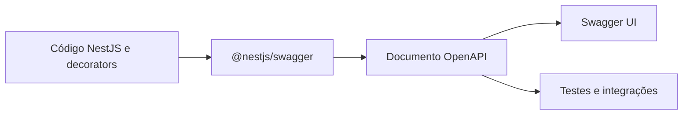
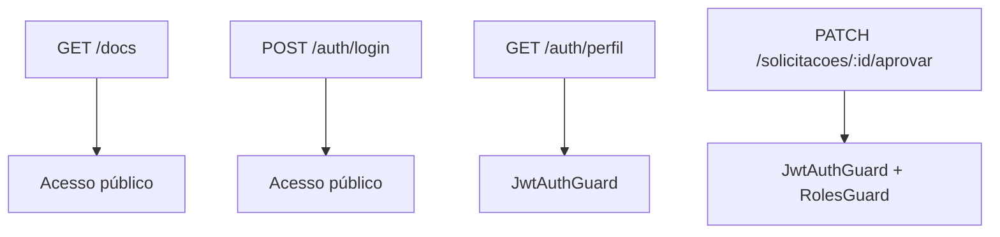
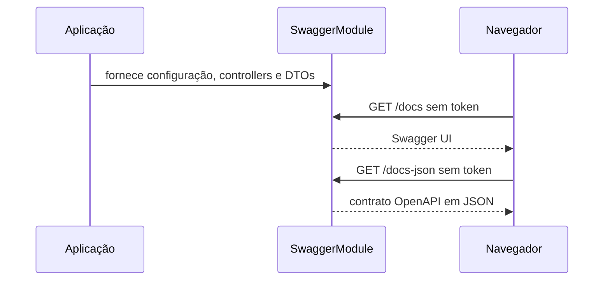
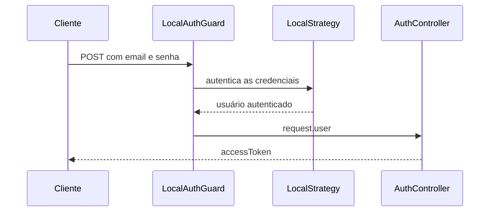
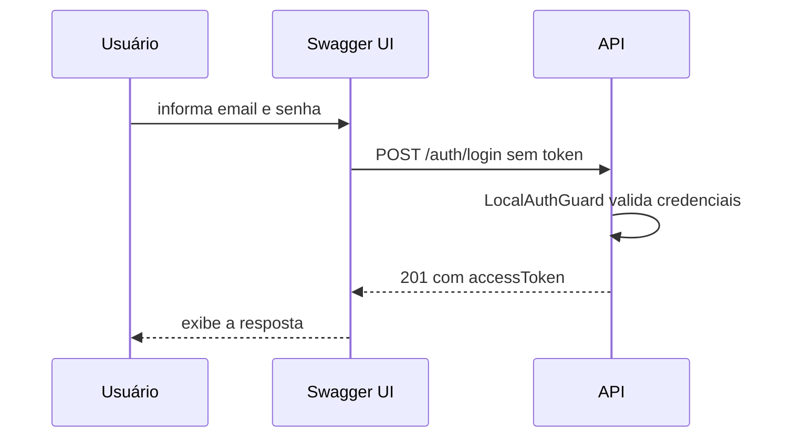
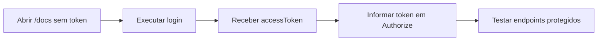

# Encontro 24 — Documentação de APIs com Swagger e OpenAPI

## Objetivo

Documentar uma API NestJS com OpenAPI e disponibilizar uma interface interativa
para consultar e testar seus endpoints.

Ao final do encontro, a aplicação deverá disponibilizar:

```text
http://localhost:3000/docs
http://localhost:3000/docs-json
```

A primeira URL apresenta a Swagger UI. A segunda fornece o contrato OpenAPI em
JSON, que pode ser lido por pessoas e por outras ferramentas.

Como exemplo, será documentado o endpoint público de login criado nos encontros
de autenticação:

```text
POST /auth/login
```

Não será necessário informar um token para abrir a documentação, consultar os
detalhes desse endpoint ou testá-lo. O próprio login é a operação usada para
obter um token, portanto exigir autenticação prévia nessa rota impediria o início
do fluxo de acesso.

## O que são OpenAPI e Swagger?

**OpenAPI** é uma especificação para descrever uma API HTTP. O documento informa
quais endpoints existem, quais dados recebem e quais respostas podem devolver.

**Swagger** é o nome associado a ferramentas que utilizam esse contrato. Neste
encontro será usada a Swagger UI, uma página gerada a partir do documento
OpenAPI.



| Elemento | Função |
|---|---|
| OpenAPI | formato padronizado que descreve o contrato |
| `@nestjs/swagger` | gera o contrato a partir da aplicação NestJS |
| Swagger UI | apresenta e permite experimentar os endpoints |
| arquivo JSON | disponibiliza o contrato para outras ferramentas |

Uma boa documentação deve permitir que outro desenvolvedor descubra:

- qual problema o endpoint resolve;
- quais dados são obrigatórios;
- qual formato deve ser enviado;
- quais respostas podem ser devolvidas;
- se a operação exige autenticação.

## Documentação pública não significa API sem segurança

Neste encontro, a página `/docs` e o endpoint `POST /auth/login` serão
públicos. Isso não remove a proteção das demais rotas.



| Recurso | Precisa de token? | Motivo |
|---|:---:|---|
| Swagger UI em `/docs` | não | permite consultar o contrato |
| login | não | recebe credenciais e emite o token |
| perfil | sim | devolve dados do usuário autenticado |
| aprovação | sim | executa uma ação restrita ao gestor |

Os guards dos endpoints protegidos continuam funcionando normalmente. Apenas a
documentação e a rota escolhida para o exemplo não exigem JWT.

## Antes de começar

Confirme que a aplicação está funcionando:

```bash
docker compose up -d
docker compose ps
```

- `docker compose up -d` inicia os serviços em segundo plano;
- `docker compose ps` mostra os contêineres e seus estados.

Se a API não estiver em execução, consulte os logs:

```bash
docker compose logs -f api
```

`logs` exibe a saída do serviço. A opção `-f` acompanha novas mensagens.
Use `Ctrl+C` para parar o acompanhamento sem encerrar o contêiner.

## Passo 1 — Instalar o módulo do Swagger

Execute na raiz do projeto:

```bash
docker compose run --rm api npm install @nestjs/swagger
```

Partes do comando:

- `docker compose run` cria um contêiner temporário;
- `--rm` remove esse contêiner ao terminar;
- `api` indica o serviço usado para executar a tarefa;
- `npm install` adiciona uma dependência ao projeto;
- `@nestjs/swagger` integra o NestJS ao OpenAPI e à Swagger UI.

O comando atualiza `package.json` e `package-lock.json`. Confira a
dependência instalada:

```bash
docker compose run --rm api npm list @nestjs/swagger
```

`npm list` mostra a versão instalada e ajuda a identificar dependências
ausentes ou incompatíveis.

## Passo 2 — Configurar o documento principal

**Arquivo:** `src/main.ts`

Acrescente este import:

```typescript
import {
  DocumentBuilder,
  SwaggerModule,
} from '@nestjs/swagger';
```

- `DocumentBuilder` constrói as informações gerais do contrato;
- `SwaggerModule` cria o documento e publica a interface no navegador.

Dentro da função `bootstrap`, depois de criar `app` e antes de
`app.listen`, acrescente:

```typescript
  const swaggerConfig = new DocumentBuilder()
    .setTitle('API de Solicitações')
    .setDescription(
      'API para criação, acompanhamento e aprovação de solicitações',
    )
    .setVersion('1.0')
    .build();

  const swaggerDocument = () =>
    SwaggerModule.createDocument(
      app,
      swaggerConfig,
    );

  SwaggerModule.setup(
    'docs',
    app,
    swaggerDocument,
    {
      jsonDocumentUrl: 'docs-json',
      customSiteTitle:
        'Documentação da API de Solicitações',
    },
  );
```

### O que cada chamada faz

| Chamada | Resultado |
|---|---|
| `setTitle` | define o nome da documentação |
| `setDescription` | explica a finalidade geral da API |
| `setVersion` | identifica a versão do contrato |
| `build` | finaliza a configuração básica |
| `createDocument` | lê controllers e DTOs para gerar o contrato |
| `SwaggerModule.setup` | publica a interface e o JSON |
| `jsonDocumentUrl` | escolhe o endereço do contrato em JSON |

Não foi usado `addBearerAuth` porque o exemplo deste encontro é público e não
precisa receber JWT. Quando os endpoints protegidos forem documentados, o
esquema Bearer poderá ser adicionado sem alterar o acesso público a `/docs`.



## Passo 3 — Abrir a documentação inicial

Recrie a API para disponibilizar a nova dependência:

```bash
docker compose up -d --build api
docker compose logs -f api
```

Depois da inicialização, abra:

```text
http://localhost:3000/docs
```

Não clique em **Authorize** e não informe token. A página deve abrir
diretamente.

Também é possível consultar o contrato pelo terminal:

```bash
curl http://localhost:3000/docs-json
```

`curl` realiza uma requisição HTTP. O comando também deve funcionar sem
cabeçalho `Authorization`.

Alguns endpoints já podem aparecer, mas os corpos e as respostas talvez estejam
incompletos. O TypeScript não conserva em tempo de execução todas as
informações necessárias para gerar sozinho uma documentação detalhada.

## Passo 4 — Criar o DTO que descreve o login

No projeto dos encontros anteriores, o `LocalAuthGuard` lê `email` e
`senha` diretamente do corpo antes de o controller ser executado. Por isso, o
método `login` recebe `@Req()`, e não `@Body()`.



Como não existe um parâmetro `@Body() dto` no controller, o Swagger não
consegue descobrir sozinho o formato das credenciais. Crie uma classe para
descrever esse contrato.

**Novo arquivo:** `src/auth/dto/login.dto.ts`

```typescript
import {
  ApiProperty,
} from '@nestjs/swagger';

export class LoginDto {
  @ApiProperty({
    description: 'E-mail usado para identificar o usuário',
    example: 'ana@empresa.com',
    format: 'email',
  })
  email: string;

  @ApiProperty({
    description: 'Senha do usuário',
    example: '123456',
    minLength: 6,
  })
  senha: string;
}
```

Esse DTO será usado por `@ApiBody` para documentar o corpo. Ele não substitui
a estratégia local nem recebe as credenciais no método do controller.

## Passo 5 — Criar o DTO da resposta

Quando as credenciais são válidas, o service devolve um objeto com o token.

**Novo arquivo:** `src/auth/dto/login-resposta.dto.ts`

```typescript
import {
  ApiProperty,
} from '@nestjs/swagger';

export class LoginRespostaDto {
  @ApiProperty({
    description:
      'Token JWT que poderá ser usado nas rotas protegidas',
    example: 'eyJhbGciOiJIUzI1NiIsInR5cCI6IkpXVCJ9...',
  })
  accessToken: string;
}
```

| DTO | Representa |
|---|---|
| `LoginDto` | dados enviados pelo cliente |
| `LoginRespostaDto` | dado devolvido após a autenticação |

Nenhum DTO deve conter um token verdadeiro. Os valores em `example` aparecem
somente na documentação.

## Passo 6 — Identificar o grupo de autenticação

**Arquivo:** `src/auth/auth.controller.ts`

Acrescente estes imports:

```typescript
import {
  ApiTags,
} from '@nestjs/swagger';
import {
  LoginDto,
} from './dto/login.dto';
import {
  LoginRespostaDto,
} from './dto/login-resposta.dto';
```

Antes de `@Controller('auth')`, acrescente:

```typescript
@ApiTags('Autenticação')
@Controller('auth')
export class AuthController {
```

Não duplique `@Controller` nem a declaração da classe. O trecho mostra a ordem
final.

`@ApiTags('Autenticação')` cria um grupo com esse nome na Swagger UI. Não foi
adicionado `@ApiBearerAuth`, pois o login não recebe token.

## Passo 7 — Documentar a operação de login

**Arquivo:** `src/auth/auth.controller.ts`

Substitua o import do Swagger pelo bloco completo:

```typescript
import {
  ApiBody,
  ApiCreatedResponse,
  ApiOperation,
  ApiTags,
  ApiUnauthorizedResponse,
} from '@nestjs/swagger';
```

Localize o método `login`. Mantenha o guard e a rota, adicionando os
decorators de documentação:

```typescript
  @UseGuards(LocalAuthGuard)
  @Post('login')
  @ApiOperation({
    summary: 'Autenticar um usuário',
    description:
      'Valida e-mail e senha e devolve um token JWT quando as credenciais são válidas.',
  })
  @ApiBody({
    type: LoginDto,
    description: 'Credenciais do usuário',
  })
  @ApiCreatedResponse({
    description: 'Usuário autenticado com sucesso',
    type: LoginRespostaDto,
  })
  @ApiUnauthorizedResponse({
    description:
      'E-mail, senha ou situação da conta não permite a autenticação',
  })
  login(@Req() request: RequisicaoAutenticada) {
    return this.authService.login(request.user);
  }
```

### O que cada decorator informa

| Decorator | Informação acrescentada |
|---|---|
| `@ApiOperation` | finalidade do login |
| `@ApiBody` | corpo que o guard espera receber |
| `@ApiCreatedResponse` | resposta HTTP 201 com o token |
| `@ApiUnauthorizedResponse` | possibilidade de HTTP 401 |

`@ApiBody` é importante neste exemplo porque o corpo é consumido pelo
`LocalAuthGuard`. O decorator documenta o corpo, mas não muda a execução do
guard.

Os decorators de resposta também não produzem os códigos HTTP. Eles apenas
descrevem comportamentos que já existem na aplicação.

## Passo 8 — Conferir a documentação gerada

Salve os arquivos e acompanhe a compilação:

```bash
docker compose logs -f api
```

Atualize `http://localhost:3000/docs`. O grupo **Autenticação** deverá mostrar
`POST /auth/login` com:

- descrição da operação;
- corpo contendo `email` e `senha`;
- exemplo de credenciais;
- resposta 201 com `accessToken`;
- resposta 401 para credenciais inválidas;
- nenhuma exigência de token Bearer.

Confira também o documento:

```bash
curl -s http://localhost:3000/docs-json
```

- `-s` remove informações de progresso;
- `paths` descreve os endpoints;
- `components.schemas` reúne os DTOs;
- o login não deve declarar uma exigência de segurança Bearer.

## Passo 9 — Testar o login sem token

Na operação `POST /auth/login`:

1. clique em **Try it out**;
2. mantenha ou ajuste as credenciais do exemplo;
3. clique em **Execute**.

```json
{
  "email": "ana@empresa.com",
  "senha": "123456"
}
```

Não use o botão **Authorize** e não acrescente o cabeçalho
`Authorization`.

Para o usuário didático dos encontros anteriores, o resultado esperado é:

```json
{
  "accessToken": "eyJ..."
}
```

O status esperado é `201 Created`. O token exibido na resposta é novo e foi
emitido pela aplicação; o valor abreviado na documentação é apenas um exemplo.



## Passo 10 — Testar uma falha

Execute novamente com uma senha incorreta:

```json
{
  "email": "ana@empresa.com",
  "senha": "senha-incorreta"
}
```

O resultado esperado é `401 Unauthorized`. A aplicação não deve informar se o
e-mail existe, se a senha está errada ou se a conta está inativa. Uma resposta
genérica reduz a exposição de informações sobre usuários cadastrados.

| Cenário | Resultado esperado |
|---|---|
| credenciais válidas | `201` com `accessToken` |
| e-mail inexistente | `401` |
| senha incorreta | `401` |
| conta inativa | `401` |
| requisição sem token | login continua acessível |

## Passo 11 — Entender os limites dos exemplos

O Swagger torna a API mais fácil de experimentar, mas os exemplos não são
configurações de segurança nem dados para produção.

| Pode aparecer | Não deve aparecer |
|---|---|
| usuário didático local | senha real de uma pessoa |
| token fictício e abreviado | token válido |
| formato esperado do corpo | segredo de assinatura do JWT |
| resposta de erro objetiva | stack trace interno |

A senha `123456` pertence somente ao laboratório didático apresentado nos
encontros anteriores. Ela não é uma recomendação para sistemas reais.

## Passo 12 — Documentar um endpoint protegido depois

Quando a turma documentar endpoints protegidos, será necessário registrar o
esquema Bearer no `DocumentBuilder` e indicar `@ApiBearerAuth` somente nos
controllers ou métodos que usam JWT.

Essa evolução não deve proteger a rota `/docs` nem o login. O fluxo esperado
continuará sendo:



Assim, a documentação pode ser consultada antes da autenticação, enquanto as
operações de negócio continuam protegidas.

## Passo 13 — Aplicar o padrão a outro endpoint público

Se o projeto possuir outro endpoint público, documente-o com:

- `@ApiTags`;
- `@ApiOperation`;
- `@ApiBody`, quando o corpo não puder ser inferido;
- DTOs de entrada e resposta;
- respostas de sucesso e erro realmente possíveis.

Não remova guards de uma rota apenas para facilitar o teste pelo Swagger. Caso
não exista outro endpoint público, revise e melhore a documentação do login.

## Verificação final

- [ ] `@nestjs/swagger` foi instalado;
- [ ] `/docs` abre sem token;
- [ ] `/docs-json` responde sem token;
- [ ] o login aparece no grupo **Autenticação**;
- [ ] `email` e `senha` aparecem no corpo;
- [ ] a resposta mostra `accessToken`;
- [ ] as respostas 201 e 401 estão documentadas;
- [ ] o login não apresenta cadeado nem exige **Authorize**;
- [ ] credenciais válidas podem ser testadas pela página;
- [ ] nenhum token real aparece nos exemplos;
- [ ] os guards das demais rotas permanecem inalterados.

## Resultado do encontro

A aplicação passa a disponibilizar uma documentação OpenAPI navegável e
testável sem exigir autenticação prévia. O endpoint público de login demonstra
como documentar um corpo consumido por guard, respostas de sucesso e falha e o
token devolvido pela API.

A documentação facilita o entendimento do sistema sem enfraquecer a segurança
dos endpoints protegidos.
