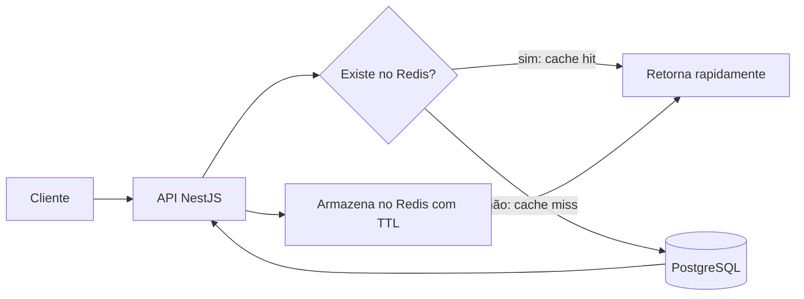
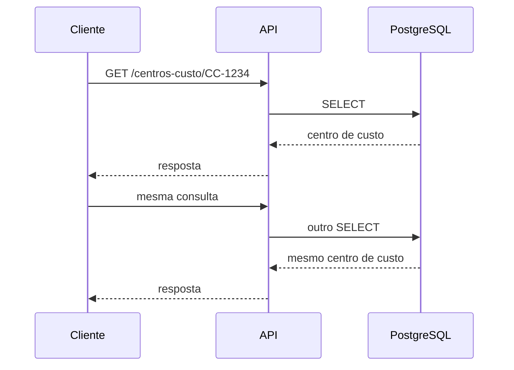
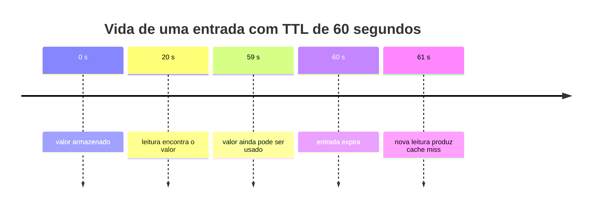
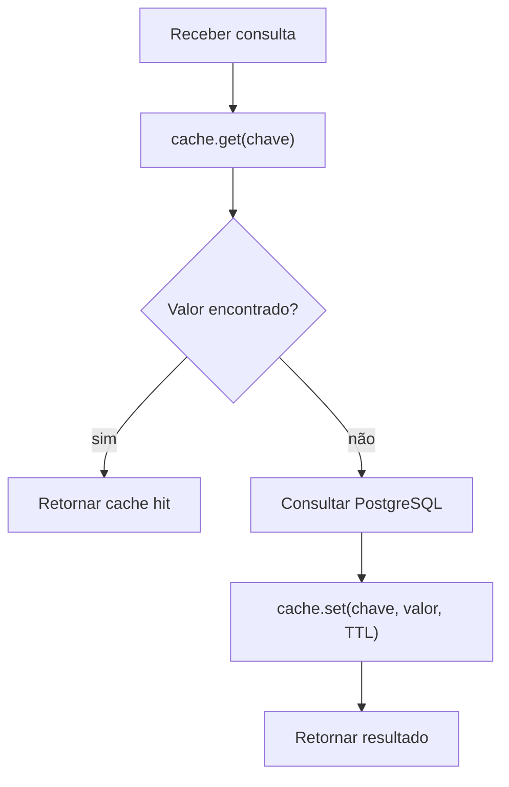
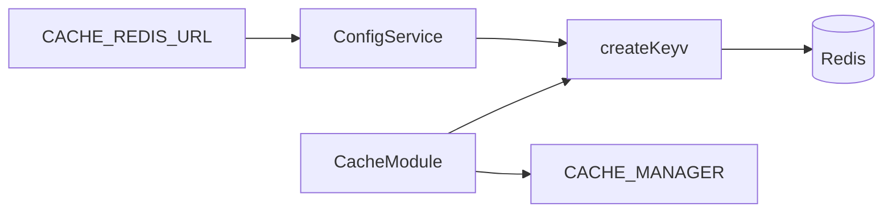
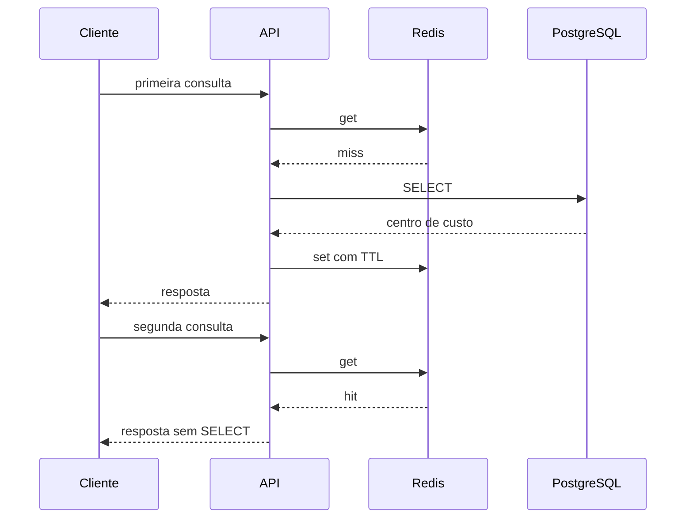
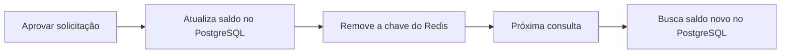
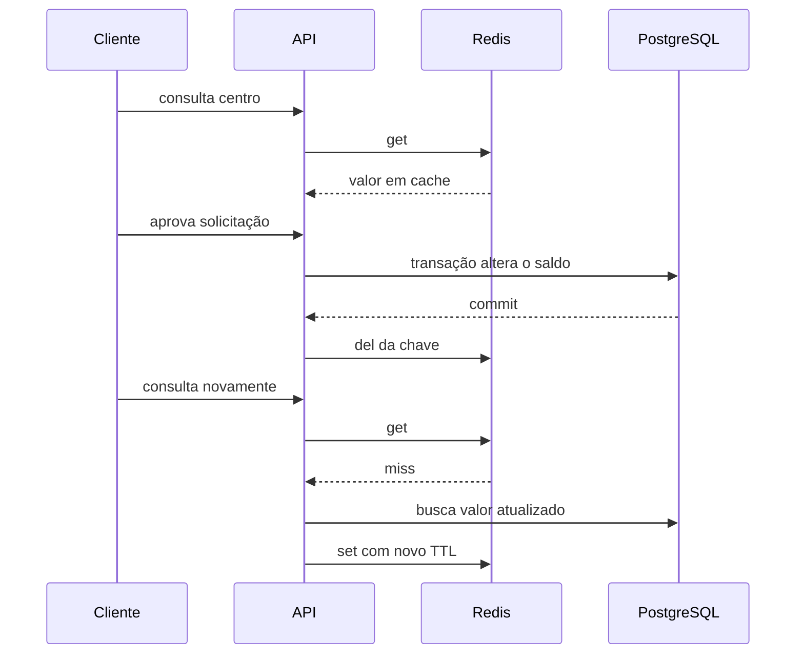
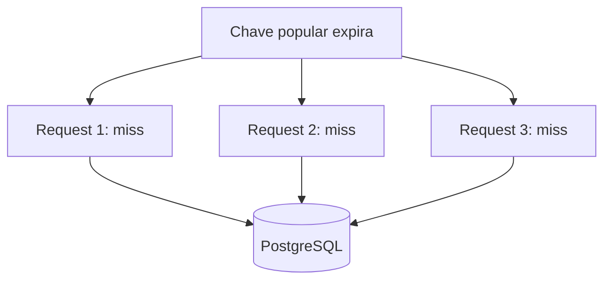

# Encontro 25 — Cache com NestJS e Redis

## Objetivo

Compreender quando o uso de cache é adequado e implementar o padrão
**cache-aside** na API NestJS desenvolvida nos encontros anteriores.

O exemplo armazenará temporariamente no Redis o resultado da consulta:

```text
GET /centros-custo/:codigo
```

O PostgreSQL continuará sendo a fonte oficial dos dados. O Redis será usado
somente para evitar consultas repetidas de informações que não mudam a cada
requisição.

Ao final do encontro, o fluxo deverá funcionar assim:



## O problema que o cache procura resolver

Sem cache, duas requisições iguais percorrem todo o caminho até o banco:



Em uma aplicação com muitas leituras repetidas, isso pode aumentar:

- o tempo de resposta;
- o número de consultas;
- o uso do pool de conexões;
- o consumo de CPU e memória do banco;
- o impacto de picos de acesso.

O cache mantém uma cópia temporária próxima da aplicação. Essa cópia pode
reduzir trabalho repetido, mas acrescenta uma nova preocupação: ela pode ficar
desatualizada.

## Conceitos fundamentais

### Cache hit e cache miss

| Situação | Significado | Ação |
|---|---|---|
| cache hit | a chave existe e ainda é válida | devolver o valor armazenado |
| cache miss | a chave não existe ou expirou | consultar a fonte oficial |
| cache write | um valor é armazenado | definir chave, conteúdo e TTL |
| invalidação | um valor deixa de ser confiável | remover ou substituir a chave |

### TTL

**TTL** significa *time to live*, ou tempo de vida. Ele define por quanto tempo
uma entrada poderá permanecer no cache.



Um TTL curto reduz o período de desatualização, mas provoca mais consultas ao
banco. Um TTL longo aumenta o aproveitamento do cache, mas exige maior cuidado
com invalidação.

### Fonte oficial

Neste exemplo:

| Componente | Responsabilidade |
|---|---|
| PostgreSQL | manter o estado oficial e durável |
| Redis | guardar cópias temporárias |
| NestJS | decidir quando ler, preencher e invalidar o cache |

Se o Redis perder todas as chaves, a aplicação deverá continuar capaz de
recuperar os dados do PostgreSQL.

## O que deve ser armazenado em cache?

Cache costuma ser útil quando:

- a leitura acontece com frequência;
- a consulta possui algum custo;
- muitas requisições pedem o mesmo resultado;
- pequenas janelas de desatualização são aceitáveis;
- o valor pode ser reconstruído a partir da fonte oficial.

Evite usar cache apenas porque Redis está disponível.

| Exemplo | Avaliação |
|---|---|
| catálogo consultado repetidamente | bom candidato |
| configuração pública pouco alterada | bom candidato |
| consulta de centro de custo | possível, com invalidação |
| senha ou token em texto aberto | não armazenar |
| saldo usado para autorizar uma transação | não confiar na cópia |
| dado consultado apenas uma vez | pouco benefício |

O saldo do centro de custo aparecerá na resposta armazenada, mas a aprovação
continuará conferindo e atualizando o PostgreSQL dentro de uma transação. A
regra de negócio nunca tomará a decisão financeira com base no cache.

## Estratégia

**cache-aside**: aplicação procura no cache e busca no banco em caso de miss.

Usaremos **cache-aside** porque o comportamento fica explícito no service e o
banco continua sendo a referência.



## Passo 1 — Adicionar o Redis ao Docker Compose

**Arquivo:** `compose.yaml`

Dentro de `services`, acrescente:

```yaml
  redis:
    image: redis:7-alpine
    command:
      - redis-server
      - --save
      - ""
      - --appendonly
      - "no"
      - --maxmemory
      - "128mb"
      - --maxmemory-policy
      - allkeys-lru
    healthcheck:
      test: ["CMD", "redis-cli", "ping"]
      interval: 5s
      timeout: 3s
      retries: 10
```

### Explicação da configuração

| Item | Função |
|---|---|
| `redis:7-alpine` | usa Redis 7 em uma imagem compacta |
| `redis-server` | inicia o servidor |
| `--save ""` | desativa snapshots periódicos |
| `--appendonly no` | desativa o log de persistência |
| `--maxmemory 128mb` | limita a memória usada no laboratório |
| `allkeys-lru` | remove chaves menos usadas quando o limite é atingido |
| `healthcheck` | verifica se o servidor responde |

A persistência foi desativada porque esse Redis será usado como cache. Perder as
chaves não pode significar perder os dados oficiais.

Não aplique ao Redis a configuração de usuário usada para impedir arquivos
`root` no serviço da API. A imagem possui sua própria organização interna.

No serviço `api`, acrescente o Redis às dependências já existentes:

```yaml
  api:
    depends_on:
      redis:
        condition: service_healthy
```

Combine esse trecho com as dependências de PostgreSQL e MongoDB. Não remova as
configurações existentes.

## Passo 2 — Configurar o endereço do Redis

**Arquivo:** `.env`

Acrescente:

```ini
CACHE_REDIS_URL=redis://redis:6379
```

**Arquivo:** `.env.example`

Documente a mesma variável:

```ini
CACHE_REDIS_URL=redis://redis:6379
```

Partes do endereço:

| Parte | Significado |
|---|---|
| `redis://` | protocolo de conexão |
| `redis` | nome do serviço no Compose |
| `6379` | porta padrão dentro da rede Docker |

Dentro do contêiner da API, `localhost` aponta para a própria API. Por isso, o
host da conexão deve ser o nome do serviço `redis`.

## Passo 3 — Iniciar e verificar o Redis

Recrie os serviços:

```bash
docker compose up -d --build
docker compose ps
```

- `up -d` inicia os contêineres em segundo plano;
- `--build` reconstrói a imagem da API quando necessário;
- `ps` permite conferir o estado e o healthcheck.

Teste diretamente o servidor:

```bash
docker compose exec redis redis-cli ping
```

- `exec redis` executa um comando no contêiner ativo do Redis;
- `redis-cli` é o cliente de linha de comando;
- `ping` verifica a comunicação com o servidor.

Resultado esperado:

```text
PONG
```

`PING` não verifica a integração da API, mas confirma que o servidor Redis
está disponível.

## Passo 4 — Instalar as dependências

Execute:

```bash
docker compose run --rm api npm install @nestjs/cache-manager cache-manager @keyv/redis
```

| Pacote | Responsabilidade |
|---|---|
| `@nestjs/cache-manager` | integração do cache com módulos e injeção do NestJS |
| `cache-manager` | interface usada para `get`, `set` e `del` |
| `@keyv/redis` | adaptador que armazena as entradas no Redis |

O comando atualiza `package.json` e `package-lock.json`.

Confira as dependências:

```bash
docker compose run --rm api npm list @nestjs/cache-manager cache-manager @keyv/redis
```

`npm list` mostra as versões resolvidas no projeto.

## Passo 5 — Registrar o cache na aplicação

**Arquivo:** `src/app.module.ts`

Acrescente os imports:

```typescript
import {
  CacheModule,
} from '@nestjs/cache-manager';
import {
  ConfigModule,
  ConfigService,
} from '@nestjs/config';
import {
  createKeyv,
} from '@keyv/redis';
```

O `ConfigModule` e o `ConfigService` provavelmente já existem por causa das
conexões com PostgreSQL e MongoDB. Combine os imports e não os duplique.

No array `imports` de `@Module`, acrescente:

```typescript
    CacheModule.registerAsync({
      isGlobal: true,
      imports: [ConfigModule],
      inject: [ConfigService],
      useFactory: async (
        configService: ConfigService,
      ) => {
        const redisStore = createKeyv(
          configService.getOrThrow<string>(
            'CACHE_REDIS_URL',
          ),
        );

        redisStore.on('error', (error) => {
          console.error(
            'Erro na conexão com o Redis',
            error,
          );
        });

        return {
          stores: [redisStore],
        };
      },
    }),
```

### Explicação dos novos elementos

| Elemento | Função |
|---|---|
| `registerAsync` | permite obter configuração durante a inicialização |
| `isGlobal: true` | disponibiliza o cache sem importar o módulo em cada recurso |
| `inject` | solicita uma instância de `ConfigService` |
| `getOrThrow` | encerra a inicialização se a variável estiver ausente |
| `createKeyv` | cria um armazenamento Keyv conectado ao Redis |
| `stores` | informa ao cache-manager onde armazenar os valores |
| listener `error` | trata erros emitidos pelo adaptador |

O listener é importante porque uma falha de conexão emitida sem tratamento pode
interromper o processo Node.js.



## Passo 6 — Definir a chave e o TTL

Usaremos uma chave por centro de custo:

```text
centro-custo:CC-1234
```

O prefixo identifica o tipo do recurso e o código identifica o registro.

| Chave | Representa |
|---|---|
| `centro-custo:CC-1234` | centro de custo CC-1234 |
| `centro-custo:TI-01` | centro de custo TI-01 |

O TTL do exemplo será de 60 segundos:

```typescript
const TTL_CENTRO_CUSTO_MS = 60_000;
```

O valor é informado em milissegundos:

```text
60 segundos × 1.000 = 60.000 milissegundos
```

Evite chaves vagas como `item` ou `dados`. Uma convenção previsível facilita
diagnóstico e invalidação.

## Passo 7 — Injetar o gerenciador de cache

**Arquivo:** `src/centros-custo/centros-custo.service.ts`

Acrescente os imports:

```typescript
import {
  CACHE_MANAGER,
} from '@nestjs/cache-manager';
import {
  Inject,
  Injectable,
  NotFoundException,
} from '@nestjs/common';
import type {
  Cache,
} from 'cache-manager';
```

Combine `Injectable` e `NotFoundException` com o import existente de
`@nestjs/common`.

No início do arquivo, depois dos imports, defina:

```typescript
const TTL_CENTRO_CUSTO_MS = 60_000;
```

Atualize o construtor:

```typescript
  constructor(
    @InjectRepository(CentroCusto)
    private readonly repository:
      Repository<CentroCusto>,

    @Inject(CACHE_MANAGER)
    private readonly cacheManager: Cache,
  ) {}
```

- `CACHE_MANAGER` é o token que identifica o cache registrado;
- `@Inject` solicita a instância associada a esse token;
- `Cache` fornece os tipos de `get`, `set` e `del`.

O service continua recebendo o repositório do TypeORM. O cache não substitui o
repositório.

## Passo 8 — Implementar cache-aside na consulta

**Arquivo:** `src/centros-custo/centros-custo.service.ts`

Substitua o método `buscarPorCodigo`:

```typescript
  async buscarPorCodigo(
    codigo: string,
  ): Promise<CentroCusto> {
    const chave =
      `centro-custo:${codigo}`;

    const valorEmCache =
      await this.cacheManager.get<CentroCusto>(
        chave,
      );

    if (
      valorEmCache !== undefined &&
      valorEmCache !== null
    ) {
      console.log(
        `CACHE HIT: ${chave}`,
      );
      return valorEmCache;
    }

    console.log(
      `CACHE MISS: ${chave}`,
    );

    const centro =
      await this.repository.findOneBy({
        codigo,
      });

    if (!centro) {
      throw new NotFoundException(
        'Centro de custo não encontrado',
      );
    }

    await this.cacheManager.set(
      chave,
      centro,
      TTL_CENTRO_CUSTO_MS,
    );

    return centro;
  }
```

### Leitura do código por etapas

1. A chave é criada a partir do código recebido.
2. `get` procura essa chave no Redis.
3. Um valor encontrado é devolvido sem consultar PostgreSQL.
4. Um miss leva à consulta pelo repositório.
5. Um registro inexistente continua produzindo HTTP 404.
6. Um registro encontrado é armazenado com TTL.
7. O mesmo objeto é devolvido ao cliente.

As verificações de `undefined` e `null` tornam o código compatível com
comportamentos de versões diferentes do cache-manager. Não use
`if (valorEmCache)` quando valores falsy, como zero ou `false`, puderem ser
válidos.

Os `console.log` são usados apenas para visualizar o comportamento durante a
aula. Em uma aplicação real, prefira o logger estruturado e métricas de hit e
miss.

## Passo 9 — Testar hit e miss

Acompanhe os logs:

```bash
docker compose logs -f api
```

Em outro terminal, consulte duas vezes o mesmo centro de custo. Se a rota exigir
JWT no projeto, envie um token válido como já foi praticado:

```bash
curl -H "Authorization: Bearer SEU_TOKEN" http://localhost:3000/centros-custo/CC-1234
```

Repita o comando antes de 60 segundos.

Resultado esperado nos logs:

```text
CACHE MISS: centro-custo:CC-1234
CACHE HIT: centro-custo:CC-1234
```

Na primeira requisição, o Redis ainda não possui a chave. Na segunda, o valor
já está disponível.



## Passo 10 — Inspecionar o Redis

Mostre quantas chaves existem:

```bash
docker compose exec redis redis-cli dbsize
```

`DBSIZE` informa a quantidade de chaves no banco Redis selecionado.

Liste as chaves de centro de custo:

```bash
docker compose exec redis redis-cli --scan --pattern '*centro-custo*'
```

- `--scan` percorre as chaves gradualmente;
- `--pattern` limita o resultado pelo padrão;
- o adaptador pode acrescentar prefixos internos à chave.

Evite usar `KEYS *` em ambientes com muitas chaves, pois ele pode bloquear o
servidor durante a varredura.

Para observar a expiração, aguarde mais de 60 segundos e consulte novamente. O
log deverá mostrar outro `CACHE MISS`, seguido de novo preenchimento.

## Passo 11 — Entender a invalidação

O TTL limita por quanto tempo um valor antigo permanece disponível, mas esperar
60 segundos pode ser inadequado após uma alteração conhecida.

No projeto, a aprovação reduz o saldo do centro de custo:



Essa remoção é chamada de **invalidação**. A próxima leitura produz um miss e
recarrega o valor atualizado.

## Passo 12 — Injetar o cache no service de solicitações

**Arquivo:** `src/solicitacoes/solicitacoes.service.ts`

Acrescente os imports:

```typescript
import {
  CACHE_MANAGER,
} from '@nestjs/cache-manager';
import {
  Inject,
} from '@nestjs/common';
import type {
  Cache,
} from 'cache-manager';
```

Combine `Inject` com o import existente de `@nestjs/common`.

Acrescente a dependência ao construtor, preservando o repositório e o
`DataSource`:

```typescript
  constructor(
    @InjectRepository(Solicitacao)
    private readonly repository:
      Repository<Solicitacao>,

    private readonly dataSource: DataSource,

    @Inject(CACHE_MANAGER)
    private readonly cacheManager: Cache,
  ) {}
```

Como o `CacheModule` foi registrado globalmente, não é necessário importá-lo
novamente no `SolicitacoesModule`.

## Passo 13 — Invalidar depois da transação

**Arquivo:** `src/solicitacoes/solicitacoes.service.ts`

No método `aprovar`, a implementação anterior começa retornando diretamente a
transação:

```typescript
return this.dataSource.transaction(
  async (manager) => {
```

Troque o retorno direto por uma variável:

```typescript
const solicitacaoAprovada =
  await this.dataSource.transaction(
    async (manager) => {
```

Mantenha todo o conteúdo interno da transação. Depois do fechamento
`});`, acrescente:

```typescript
  const chave =
    `centro-custo:${solicitacaoAprovada.centroCusto}`;

  try {
    await this.cacheManager.del(chave);

    console.log(
      `CACHE INVALIDADO: ${chave}`,
    );
  } catch (error) {
    console.error(
      `FALHA AO INVALIDAR: ${chave}`,
      error,
    );
  }

  return solicitacaoAprovada;
```

O formato final do método será:

```typescript
async aprovar(
  id: number,
  versaoSolicitacao: number,
  versaoCentroCusto: number,
  atorId: number,
) {
  const solicitacaoAprovada =
    await this.dataSource.transaction(
      async (manager) => {
        // Mantenha aqui toda a implementação
        // transacional construída no encontro 13.
      },
    );

  const chave =
    `centro-custo:${solicitacaoAprovada.centroCusto}`;

  try {
    await this.cacheManager.del(chave);

    console.log(
      `CACHE INVALIDADO: ${chave}`,
    );
  } catch (error) {
    console.error(
      `FALHA AO INVALIDAR: ${chave}`,
      error,
    );
  }

  return solicitacaoAprovada;
}
```

O comentário representa o código existente; ele não deve substituir a
implementação da transação.

### Por que invalidar depois do commit?

Se a transação falhar, o saldo não será alterado e a entrada ainda representa o
banco. Ao aguardar a conclusão da transação antes de chamar `del`, a aplicação
remove a chave somente depois da confirmação da mudança.

O `try/catch` impede que uma falha do Redis transforme em erro HTTP uma
aprovação que já foi confirmada no PostgreSQL. Se a remoção falhar, a ocorrência
é registrada e o TTL limita por quanto tempo a cópia antiga poderá permanecer.
Em produção, essa falha também deve gerar métrica ou alerta.

| Ordem | Problema ou resultado |
|---|---|
| invalidar antes da transação | outro request pode preencher o cache com o valor antigo |
| invalidar dentro de transação que falha | chave é removida sem mudança no banco |
| invalidar depois do commit | próxima leitura busca o valor confirmado |

Ainda existe uma pequena janela entre o commit e a remoção. Sistemas com
requisitos mais rigorosos precisam de estratégias adicionais, como eventos
confiáveis, versionamento de chaves ou outbox.

## Passo 14 — Testar a invalidação

1. Consulte o centro de custo duas vezes para gerar miss e hit.
2. Aprove uma solicitação ligada a esse centro.
3. Observe `CACHE INVALIDADO` nos logs.
4. Consulte novamente o centro de custo.
5. Confirme um novo miss e o saldo atualizado.

Fluxo esperado:

```text
CACHE MISS: centro-custo:CC-1234
CACHE HIT: centro-custo:CC-1234
CACHE INVALIDADO: centro-custo:CC-1234
CACHE MISS: centro-custo:CC-1234
CACHE HIT: centro-custo:CC-1234
```



## Passo 15 — Simular a perda do cache

Remova todas as chaves do Redis do laboratório:

```bash
docker compose exec redis redis-cli flushdb
```

`FLUSHDB` apaga todas as chaves do banco Redis selecionado. Use esse comando
somente no ambiente didático e nunca em um Redis compartilhado sem confirmar o
alvo.

Consulte novamente o centro de custo. A API deve buscar o PostgreSQL e
reconstruir a entrada.

Isso confirma uma propriedade importante:

```text
perder o cache causa perda de desempenho temporária,
mas não pode causar perda do dado oficial
```

## Passo 16 — Reconhecer riscos

### Cache stampede

Se uma chave muito acessada expirar, muitas requisições simultâneas podem
consultar o banco antes que a primeira consiga repor o valor.



Possíveis tratamentos incluem lock por chave, atualização antecipada, TTL com
variação e deduplicação de consultas em andamento. Eles não serão implementados
neste encontro, mas devem ser considerados em cargas elevadas.

### Dados desatualizados

TTL não garante atualização imediata. Invalidações esquecidas podem manter uma
cópia antiga até a expiração.

### Redis indisponível

Cache é uma otimização. Uma aplicação robusta deve definir se:

- falha rapidamente e informa indisponibilidade;
- ignora temporariamente o cache e consulta o banco;
- usa cache em memória como primeira camada.

A escolha depende do impacto, da carga suportada pelo banco e dos requisitos do
sistema.

## Passo 17 — O que medir

Não conclua que o cache melhorou o sistema apenas porque ele foi adicionado.
Registre e compare:

| Métrica | Pergunta respondida |
|---|---|
| hit rate | qual proporção das leituras foi atendida pelo cache? |
| latência | respostas ficaram mais rápidas? |
| consultas ao banco | a carga do PostgreSQL diminuiu? |
| uso de memória | quanto espaço o Redis consome? |
| evictions | chaves estão sendo removidas por falta de memória? |
| erros do Redis | o cache está introduzindo falhas? |

A taxa de acertos pode ser calculada por:

```text
hit rate = hits ÷ (hits + misses) × 100
```

Exemplo:

```text
80 hits ÷ (80 hits + 20 misses) × 100 = 80%
```

O encontro 28 aprofundará medições, testes de carga e decisões de escala.

## Exercício de fixação

Adicione cache a uma consulta de leitura do projeto final ou a outro endpoint da
API.

A implementação deverá:

1. definir uma chave clara;
2. escolher e justificar um TTL;
3. implementar cache-aside;
4. manter o banco como fonte oficial;
5. invalidar a chave quando o dado for alterado;
6. demonstrar um miss, um hit e uma invalidação;
7. explicar qual risco existe se a invalidação falhar.

Não use dados sensíveis e não armazene no cache uma decisão que precise ser
transacionalmente correta.

## Verificação final

- [ ] o Redis inicia com Docker Compose;
- [ ] `redis-cli ping` responde `PONG`;
- [ ] a URL do Redis está no `.env` e no `.env.example`;
- [ ] as dependências foram instaladas;
- [ ] o `CacheModule` usa o adaptador Redis;
- [ ] erros do adaptador possuem listener;
- [ ] a consulta implementa cache-aside;
- [ ] a chave identifica claramente o recurso;
- [ ] o valor possui TTL;
- [ ] a primeira consulta produz miss;
- [ ] a segunda consulta produz hit;
- [ ] a aprovação invalida a chave depois da transação;
- [ ] a consulta seguinte retorna o saldo atualizado;
- [ ] apagar o cache não elimina dados oficiais;
- [ ] os limites e riscos do cache foram discutidos.

## Resultado do encontro

A API passa a utilizar Redis como cache distribuído para leituras de centros de
custo. O PostgreSQL permanece como fonte oficial, o TTL limita a duração da
cópia e a aprovação invalida o valor depois de alterar o saldo.

O principal aprendizado não é apenas executar `get` e `set`, mas decidir o
que pode ser armazenado, por quanto tempo, quando invalidar e como verificar se
o cache realmente trouxe benefício.
