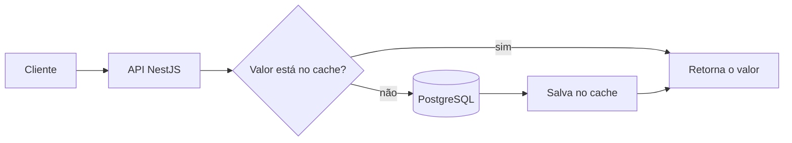
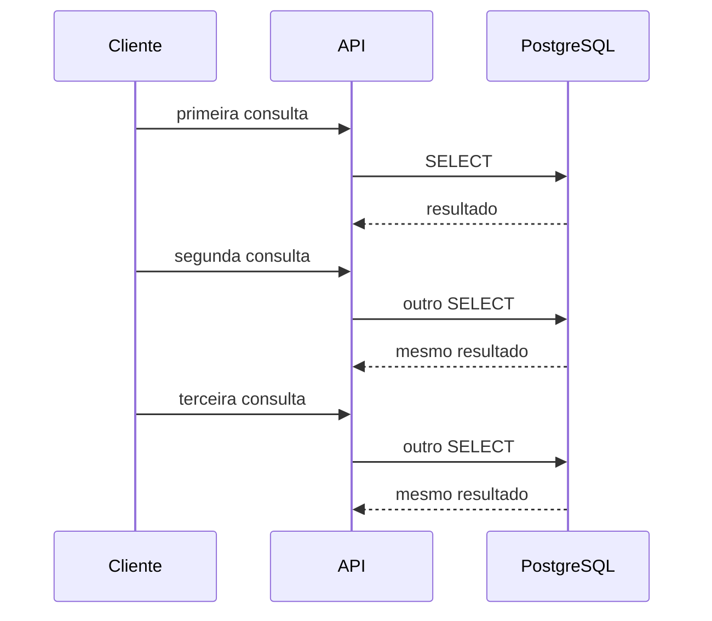
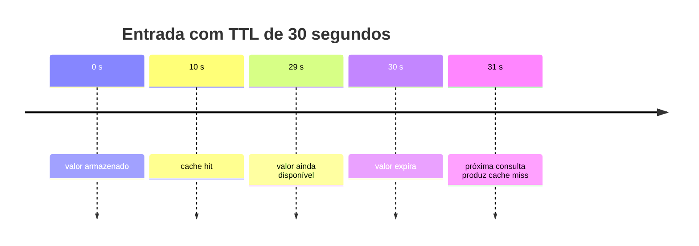
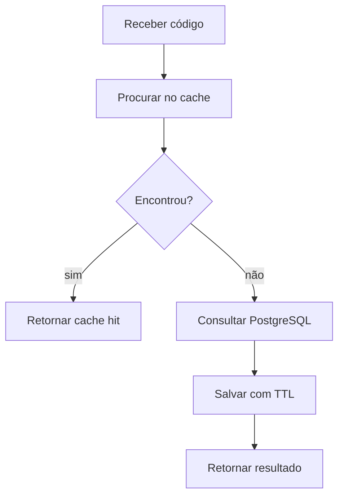
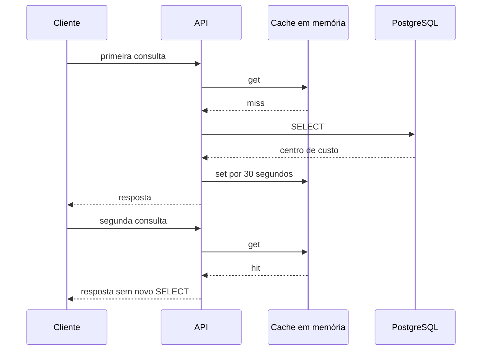
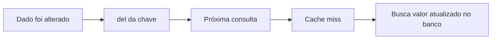

# Encontro 25 — Introdução ao cache no NestJS

## Objetivo

Compreender o funcionamento básico de um cache e adicionar um exemplo simples
à API NestJS desenvolvida nos encontros anteriores.

O exemplo armazenará temporariamente na memória da aplicação o resultado da
consulta:

```text
GET /centros-custo/:codigo
```

Não será necessário instalar Redis, alterar o Docker Compose ou criar outro
serviço. O objetivo é observar o funcionamento de `get`, `set`, cache hit,
cache miss e TTL antes de estudar configurações mais avançadas.

## O que é cache?

Cache é um armazenamento temporário usado para evitar a repetição de uma
operação. Em vez de consultar o banco em todas as requisições, a aplicação pode
reutilizar por algum tempo um resultado consultado anteriormente.



O PostgreSQL continua sendo a fonte oficial dos dados. O cache guarda apenas
uma cópia temporária.

## Exemplo sem cache

Considere três consultas seguidas ao mesmo centro de custo:

```text
GET /centros-custo/CC-1234
GET /centros-custo/CC-1234
GET /centros-custo/CC-1234
```

Sem cache, as três requisições consultam o PostgreSQL:



Com cache, apenas a primeira consulta precisa chegar ao banco. As próximas
podem reutilizar o resultado enquanto ele estiver válido.

## Três conceitos importantes

### Cache miss

Ocorre quando a aplicação procura uma chave e não encontra um valor válido.
Nesse caso, ela consulta o banco.

### Cache hit

Ocorre quando a chave já existe. A aplicação devolve o valor armazenado sem
consultar novamente o banco.

### TTL

**TTL** significa *time to live*, ou tempo de vida. Ele determina por quanto
tempo um valor poderá permanecer no cache.

Neste exemplo, o TTL será de 30 segundos:

```text
30 segundos × 1.000 = 30.000 milissegundos
```



## Quando o cache pode ajudar?

Um dado pode ser um bom candidato quando:

- é consultado muitas vezes;
- não muda a cada requisição;
- pode ser obtido novamente no banco;
- uma pequena janela de desatualização é aceitável.

Alguns exemplos:

| Dado | Cache pode ajudar? |
|---|:---:|
| catálogo consultado frequentemente | sim |
| configuração pública pouco alterada | sim |
| consulta de centro de custo | sim, com cuidado |
| senha em texto aberto | não |
| dado usado para decidir uma transação financeira | não |

No projeto, o cache será usado somente na consulta do centro de custo. A
aprovação continuará consultando e alterando o PostgreSQL dentro da transação.

## Fluxo usado no exemplo

Aplicaremos uma versão simples do padrão **cache-aside**:



O cache será preenchido somente quando uma consulta for realizada.

## Passo 1 — Instalar as dependências

Na raiz do projeto, execute:

```bash
docker compose run --rm api npm install @nestjs/cache-manager cache-manager
```

Partes do comando:

- `docker compose run` cria um contêiner temporário;
- `--rm` remove o contêiner ao finalizar;
- `api` indica o serviço usado para executar o comando;
- `npm install` adiciona as dependências ao projeto;
- `@nestjs/cache-manager` integra o cache ao NestJS;
- `cache-manager` fornece as operações de leitura e escrita.

O comando atualiza `package.json` e `package-lock.json`.

Confira a instalação:

```bash
docker compose run --rm api npm list @nestjs/cache-manager cache-manager
```

`npm list` mostra as versões instaladas.

## Passo 2 — Registrar o módulo de cache

**Arquivo:** `src/app.module.ts`

Acrescente o import:

```typescript
import {
  CacheModule,
} from '@nestjs/cache-manager';
```

No array `imports` de `@Module`, acrescente:

```typescript
CacheModule.register({
  isGlobal: true,
}),
```

O trecho deve ser combinado com os módulos já existentes:

```typescript
@Module({
  imports: [
    CacheModule.register({
      isGlobal: true,
    }),
    // Mantenha os outros módulos existentes.
  ],
})
export class AppModule {}
```

### O que essa configuração faz?

| Elemento | Função |
|---|---|
| `CacheModule` | disponibiliza o cache na aplicação |
| `register` | cria uma configuração simples |
| `isGlobal: true` | permite injetar o cache em outros módulos |

Como nenhum armazenamento externo foi configurado, os valores serão mantidos
na memória do processo da API.

Isso significa que o cache será perdido quando:

- a API for reiniciada;
- o contêiner for recriado;
- o processo for encerrado.

Para este primeiro exemplo, esse comportamento é suficiente.

## Passo 3 — Injetar o cache no service

**Arquivo:** `src/centros-custo/centros-custo.service.ts`

Acrescente os imports:

```typescript
import {
  CACHE_MANAGER,
} from '@nestjs/cache-manager';
import {
  Inject,
  Injectable,
  NotFoundException,
} from '@nestjs/common';
import type {
  Cache,
} from 'cache-manager';
```

Combine `Injectable` e `NotFoundException` com o import que já existe. Não
duplique imports do mesmo módulo.

Depois dos imports, defina o TTL:

```typescript
const TTL_CENTRO_CUSTO_MS = 30_000;
```

Atualize o construtor do service:

```typescript
constructor(
  @InjectRepository(CentroCusto)
  private readonly repository:
    Repository<CentroCusto>,

  @Inject(CACHE_MANAGER)
  private readonly cacheManager: Cache,
) {}
```

### O que foi adicionado?

| Elemento | Função |
|---|---|
| `CACHE_MANAGER` | identifica o cache registrado no NestJS |
| `@Inject` | solicita essa dependência ao container do NestJS |
| `Cache` | fornece os tipos de `get`, `set` e `del` |
| `TTL_CENTRO_CUSTO_MS` | define o tempo de vida em milissegundos |

O repositório do TypeORM continua disponível. O cache não substitui o acesso ao
PostgreSQL.

## Passo 4 — Adicionar cache à consulta

**Arquivo:** `src/centros-custo/centros-custo.service.ts`

Substitua o método `buscarPorCodigo`:

```typescript
async buscarPorCodigo(
  codigo: string,
): Promise<CentroCusto> {
  const chave =
    `centro-custo:${codigo}`;

  const valorEmCache =
    await this.cacheManager.get<CentroCusto>(
      chave,
    );

  if (
    valorEmCache !== undefined &&
    valorEmCache !== null
  ) {
    console.log(
      `CACHE HIT: ${chave}`,
    );

    return valorEmCache;
  }

  console.log(
    `CACHE MISS: ${chave}`,
  );

  const centro =
    await this.repository.findOneBy({
      codigo,
    });

  if (!centro) {
    throw new NotFoundException(
      'Centro de custo não encontrado',
    );
  }

  await this.cacheManager.set(
    chave,
    centro,
    TTL_CENTRO_CUSTO_MS,
  );

  return centro;
}
```

## Entendendo o método

### 1. Criar a chave

```typescript
const chave =
  `centro-custo:${codigo}`;
```

Para o código `CC-1234`, a chave será:

```text
centro-custo:CC-1234
```

O prefixo identifica o tipo de dado. O código diferencia um centro de custo dos
demais.

### 2. Procurar no cache

```typescript
const valorEmCache =
  await this.cacheManager.get<CentroCusto>(
    chave,
  );
```

- `get` procura um valor pela chave;
- `<CentroCusto>` informa ao TypeScript o tipo esperado;
- `await` aguarda a operação terminar.

Quando a chave não existe ou expirou, o resultado será `undefined` ou
`null`, dependendo da versão das bibliotecas. Por isso, o exemplo verifica as
duas possibilidades.

### 3. Retornar um cache hit

```typescript
if (
  valorEmCache !== undefined &&
  valorEmCache !== null
) {
  console.log(
    `CACHE HIT: ${chave}`,
  );

  return valorEmCache;
}
```

Se o valor foi encontrado, o método termina nessa etapa. O repositório não é
consultado.

### 4. Consultar o banco em um miss

```typescript
const centro =
  await this.repository.findOneBy({
    codigo,
  });
```

Quando o valor não está no cache, o service usa o repositório normalmente. A
regra de HTTP 404 permanece igual.

### 5. Armazenar o resultado

```typescript
await this.cacheManager.set(
  chave,
  centro,
  TTL_CENTRO_CUSTO_MS,
);
```

`set` recebe:

1. a chave;
2. o valor;
3. o tempo de vida em milissegundos.

Depois desse comando, uma nova consulta à mesma chave poderá produzir cache hit.

## Passo 5 — Executar a aplicação

Recrie a API para disponibilizar as novas dependências:

```bash
docker compose up -d --build api
```

Acompanhe os logs:

```bash
docker compose logs -f api
```

- `up -d` inicia o serviço em segundo plano;
- `--build` reconstrói a imagem;
- `logs -f` acompanha as mensagens geradas pela aplicação.

Os `console.log` foram adicionados somente para tornar o comportamento visível
durante a aula.

## Passo 6 — Testar cache miss e cache hit

Em outro terminal, consulte um centro de custo existente. Se a rota estiver
protegida, utilize um token JWT válido:

```bash
curl -H "Authorization: Bearer SEU_TOKEN" http://localhost:3000/centros-custo/CC-1234
```

Na primeira execução, o log deverá mostrar:

```text
CACHE MISS: centro-custo:CC-1234
```

Repita o mesmo comando antes de 30 segundos. O log deverá mostrar:

```text
CACHE HIT: centro-custo:CC-1234
```

O fluxo das duas consultas será:



## Passo 7 — Testar a expiração

Depois do cache hit:

1. aguarde mais de 30 segundos;
2. faça a mesma consulta novamente;
3. observe os logs.

Resultado esperado:

```text
CACHE MISS: centro-custo:CC-1234
```

A entrada expirou, então a aplicação consultou o PostgreSQL e armazenou uma
nova cópia.

Também é possível reiniciar a API:

```bash
docker compose restart api
```

`restart` encerra e inicia novamente o contêiner. Como o cache está na memória
do processo, a primeira consulta depois do reinício produzirá outro miss.

## Passo 8 — Remover uma entrada manualmente

Quando um dado é alterado, pode ser necessário remover a cópia antes do fim do
TTL. A operação usada para isso é `del`:

```typescript
await this.cacheManager.del(
  `centro-custo:${codigo}`,
);
```

Essa operação é chamada de **invalidação**.



Neste encontro, a invalidação é apresentada apenas como conceito e pequeno
exemplo. Não será necessário alterar o fluxo transacional de aprovação.

## Limitações do exemplo

O cache em memória é adequado para aprender, mas possui limitações:

| Limitação | Consequência |
|---|---|
| reiniciar a API limpa o cache | as entradas precisam ser reconstruídas |
| cada instância possui sua memória | duas réplicas podem ter valores diferentes |
| não há compartilhamento | outros serviços não enxergam as entradas |
| invalidação pode ser esquecida | um valor antigo permanece até o TTL |

Para aplicações com várias instâncias, pode ser usado um armazenamento
compartilhado, como Redis. Essa configuração não faz parte deste exemplo básico.

## Exercício de fixação

Altere o exemplo para que o TTL seja de 10 segundos.

Depois:

1. reinicie a API;
2. faça uma primeira consulta e identifique o cache miss;
3. repita antes de 10 segundos e identifique o cache hit;
4. aguarde mais de 10 segundos;
5. consulte novamente e confirme um novo miss;
6. explique por que o PostgreSQL continua sendo a fonte oficial.

Como extensão opcional, escolha outro endpoint somente de leitura e aplique o
mesmo padrão.

## Verificação final

- [ ] as dependências de cache foram instaladas;
- [ ] o `CacheModule` foi registrado;
- [ ] o cache está disponível globalmente;
- [ ] o service recebeu `CACHE_MANAGER`;
- [ ] a chave identifica o centro de custo;
- [ ] a primeira consulta produz cache miss;
- [ ] a segunda consulta produz cache hit;
- [ ] o valor expira depois do TTL;
- [ ] reiniciar a API limpa o cache;
- [ ] o PostgreSQL continua sendo a fonte oficial;
- [ ] as limitações do cache em memória foram compreendidas.

## Resultado do encontro

A API passa a reutilizar temporariamente o resultado da consulta de centros de
custo. O exemplo demonstra o ciclo essencial do cache:

```text
procurar → identificar miss → consultar o banco → armazenar → reutilizar
```

A implementação é propositalmente simples. Redis, múltiplas camadas, métricas e
estratégias avançadas poderão ser estudados depois que esse fluxo básico estiver
compreendido.
